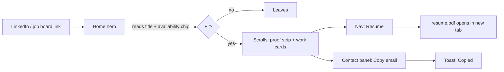
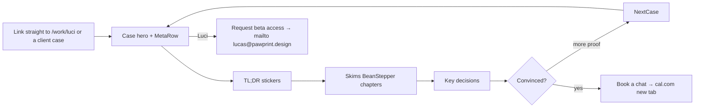
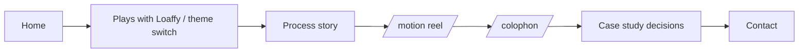
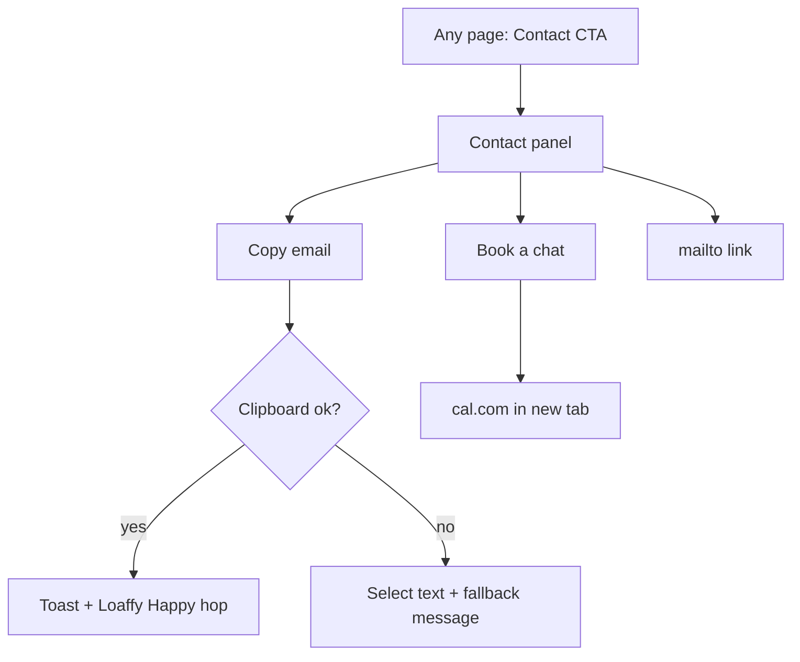
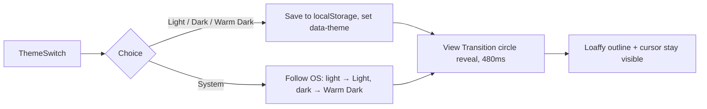

# Users & Flows

## 1. Who visits (personas)

| Persona | Context | What they need in < 60s | Success for us |
|---|---|---|---|
| **Remote recruiter** (US, CA, NZ, SG) | Screening 30+ portfolios a day, often on a phone, from a job board or LinkedIn link | Title, level, availability, time zone, resume | Downloads resume or forwards the link |
| **Hiring manager** (product lead) | Shortlisting; opens 1–2 case studies on a laptop | Problem-solving, outcomes, how you work with PMs/devs | Books a chat |
| **Design lead / peer** | Judging craft and taste | Visual quality, systems thinking, motion, details | Explores colophon, motion, case decisions |
| **Engineering lead** | Checking handoff quality | Design system, tokens, how you work with code/AI | Reads decisions + colophon |

Design rule: **every page answers the recruiter in the first screen and rewards the design lead further down.**

**Luci is the differentiator:** most candidates show client work only. Leading with a product Lucas founded, designed and built answers "can they own a product end to end?" for every persona.

## 2. Flow A — Recruiter 30-second scan

Acceptance: title, availability and Resume visible without scrolling at 375×667 and 1440×900.

## 3. Flow B — Hiring manager deep dive

Acceptance: every case study is a shareable URL (no modals), back button works, TL;DR readable in 20 seconds.

## 4. Flow C — Design lead craft check

## 5. Signature flow — the Process story (home §4)

The answer to Deno's "Better JavaScript" animation: it tells *how Lucas works* instead of decorating. Scroll-scrubbed with GSAP ScrollTrigger, pinned for ~300vh on desktop.

| Step (scroll %) | Scene | Copy (one line) |
|---|---|---|
| 0–20% **Understand** | Blank Paper artboard. Loaffy (Curious) looks around; sticky notes appear one by one | "First, I ask a lot of questions." |
| 20–45% **Shape** | The cat hand slides in from the bottom and sketches a wireframe (stroke-dashoffset lines) | "Then I sketch the flow before the pixels." |
| 45–70% **Design** | Wireframe fills with pastel UI; Loaffy squishes into a button shape (shape-shift) | "Then I design the system, not just the screen." |
| 70–90% **Motion** | The UI comes alive: cards spring, a toggle flips, a loader runs | "Then I make it move, with purpose." |
| 90–100% **Ship** | Loaffy does the Jump pose; a "Shipped" sticker lands with a soft bounce | "Then I ship it, and check it twice." |

- Mobile: not pinned; five stacked steps, each animates once when it enters the viewport.
- Reduced motion: five static frames with Next/Previous buttons (`aria-live` caption).
- Each step's copy is real text in the DOM (not baked into graphics) for screen readers and SEO.

## 6. Flow D — Contact

## 7. Flow E — Theme switch

## 8. Flow F — Lost (404)

Loaffy Lost form (beans scattered, "?"), title "Loaffy looked everywhere.", two buttons: Back home · See the work. Logs the missing path to analytics.

## 9. Flow G — Mobile navigation

Menu button → full-screen sheet slides up (spring-calm) → big links (display size) → tap closes sheet and navigates → focus returns to the menu button on close. Esc and a visible Close button both work.

## 10. Micro-interaction inventory

| Trigger | Response | Loaffy (timelines: LOAFFY-ANIMATION.md §4, §6.5) |
|---|---|---|
| Hover work card | Lift, cover wipe | Peeks in the case's form (Curious) |
| Hover logo | Bean wiggles | Wink (easter egg) |
| Copy email | Toast | Happy hop |
| Idle 30s | — | Sleepy |
| Click Loaffy ×5 | — | Mid-flip |
| Reel playing | — | Vibing |
| Scroll past hero | — | Morphs into the first case's form |
| Error / 404 | Kind message | Surprised / Lost |
